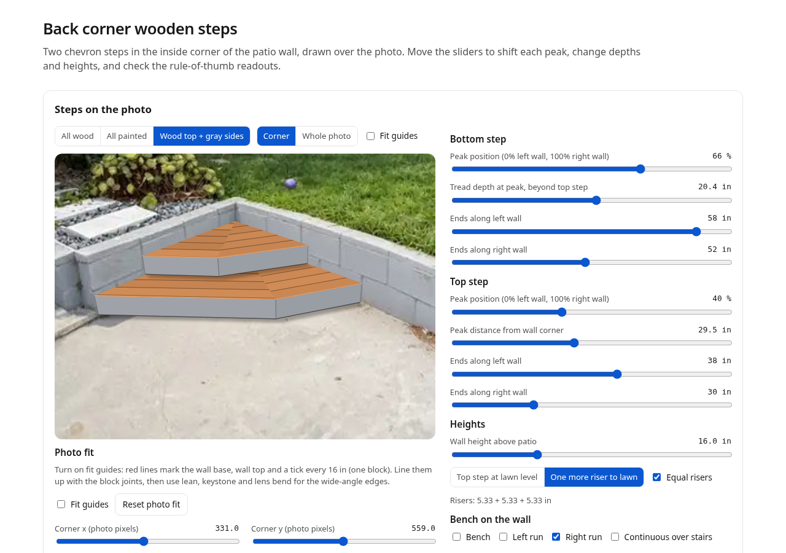

Custom steps for an odd-angled patio corner are hard to picture from a sketch, and contractor renders cost time and money. This tool draws two chevron-shaped wooden steps right onto a photo of the real corner, in correct perspective. Sliders change the peak positions, tread depths, wall lengths and riser heights. Readouts check each choice against common stair rules of thumb. A plan view gives dimensioned measurements ready to cut and build from.

Built as one self-contained HTML file in vanilla JavaScript with no dependencies. It projects the 3D steps onto the photo using a camera model fitted to the retaining wall edges. The wood finish renders came from a separate Python pipeline using NumPy and Pillow.

Live demo: [https://clever-entremet-f4ed2c.netlify.app](https://clever-entremet-f4ed2c.netlify.app)
