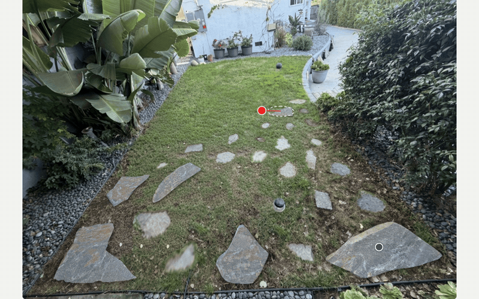

Hauling 100-pound flagstones around a lawn just to see how a layout looks is slow and backbreaking. Backyard Stone Planner lets you try layouts on a photo of the real yard first. Every stone is cut from a photo, flattened to true scale, and placed back on the ground in correct perspective. You can drag, rotate, flip and resize each stone and see what it would actually look like. Stones already in the ground were cut out too and can be moved, and each stone is lit to match its spot in the yard. Layouts save as JSON, so you can compare and share options.

Built as a single-page vanilla JavaScript and HTML5 Canvas app with no build step. Stones are placed with a ground-plane homography in inch-based coordinates, with a lens correction term and a per-pixel light map. The stone cutouts were flattened and de-lit in Python with OpenCV and NumPy.

Live demo: [https://grand-heliotrope-4bd8c4.netlify.app/](https://grand-heliotrope-4bd8c4.netlify.app/)
