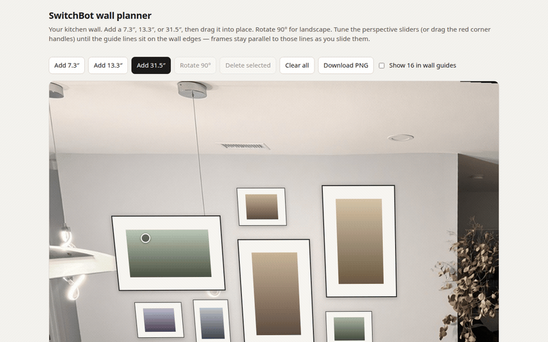

Plan a wall of E Ink art frames before you buy anything or drill a single hole. The planner shows exactly how each frame will look and fit on your real wall, at true scale. It starts from a photo of the wall that is perspective-corrected and calibrated to tape-measured dimensions. You can add frames in the three SwitchBot Art Frame sizes (7.3, 13.3, and 31.5 inches), drag them, rotate them, and save or load layouts as JSON. Frames warp to match the wall's perspective while you drag.

Built as one self-contained HTML, CSS and JavaScript file with no framework or backend. Perspective uses a 3x3 homography rendered with CSS matrix3d. The wall photo was prepared in Python with Pillow and NumPy.

Live demo: [https://dapper-naiad-5bbf14.netlify.app/](https://dapper-naiad-5bbf14.netlify.app/)

SwitchBot AI Art Frame: [https://www.switch-bot.com/products/switchbot-ai-art-frame](https://www.switch-bot.com/products/switchbot-ai-art-frame)
